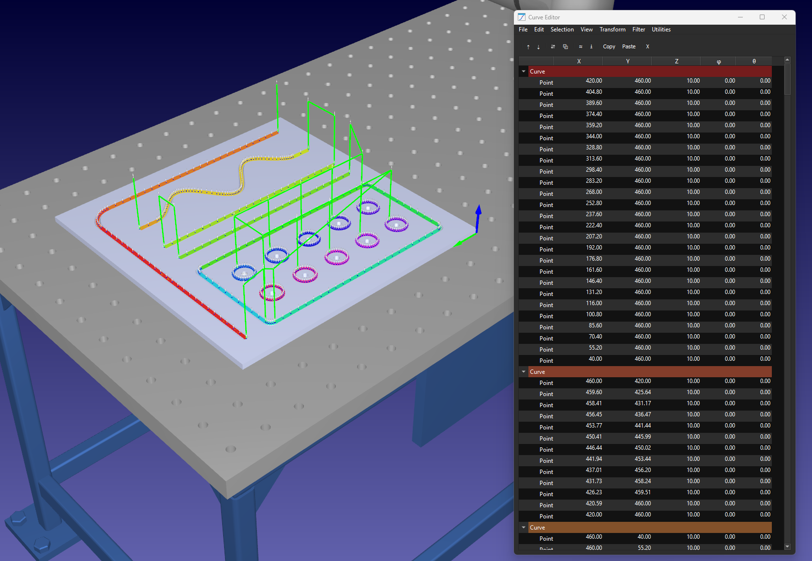

# Curve Utilities

The Curve Utilities Add-in for RoboDK adds tools to edit, import and export curves and points.

It lets you turn raw CAD, vector or scan geometry into clean, high-precision robot tool paths: project points onto a part surface, smooth noisy paths, correct tool orientations, and re-order curve segments to shorten cycle times.

You can open the editor by going to **Utilities - Curve Utilities - Open Curve Editor**, by clicking its icon in the toolbar, or by right-clicking an object or a curve in the station tree.

## Features

- **Interactive Curve Table:** Edit the position and the normal of every point, as XYZ coordinates and polar angles, with optional IJK and point-to-point distance columns. Each curve is color-coded and highlighted in the 3D view as you select it.
- **Point and Curve Management:** Cut, copy, paste, add, delete and re-order points and curves. Merge segments into a single curve, split discontinuous curves, reverse their direction, and convert curves to points or points to a curve.
- **Geometric Transforms:** Offset points relative to the axes, along their normal, or along the path tangent. Project points onto the surface of any object, bulk edit coordinates, and flip, average or set normals (absolute, relative or tangent to the path).
- **Path Filters:** Remove duplicated points, simplify straight lines, resample with a fixed step or by a factor, smooth curves with the CCMA or B-Spline filters, and sort curves by distance to reduce air travel.
- **Import and Export:** Import curves and points from CSV, SVG (`.svg`) and DXF (`.dxf`) files, extract curves from an existing robot program, and export the result back to CSV.
- **Convert to Targets:** Turn any selection of curves or points into robot targets, with the tool Z axis aligned to the point normals.

## Usage

Open the Curve Editor and select an object in the RoboDK station tree to load its curves and points in the table. The editor follows the station selection, one object at a time, so selecting another object loads it instead.

Select the rows you want to work on, then apply a command from the **Transform**, **Filter** or **Utilities** menu, or use the toolbar shortcuts. If nothing is selected, the command applies to all the curves and points. Changes are applied to the object right away so you can see the result in the 3D view. Use **File - Revert All Changes** to restore the geometry as it was when the object was loaded.

Use **Utilities - Convert to Targets** to create robot targets from your path, or point a Curve Follow Project to the edited object to generate a robot program.

**Note:** The editor rewrites the curves of the object, so the original curve colors are lost.
